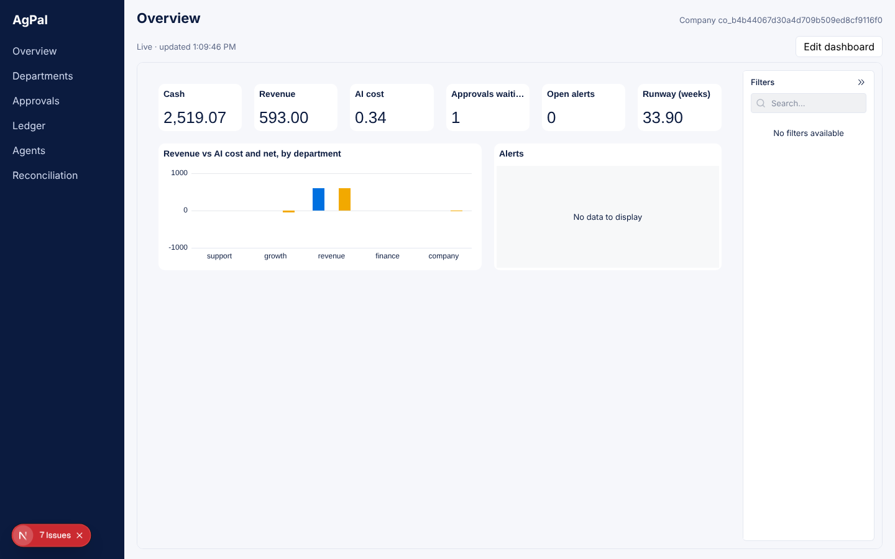
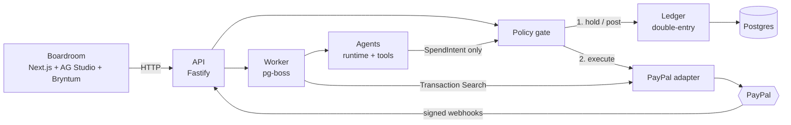

# AgPal — a company whose employees are AI agents, and whose money runs on PayPal

AgPal is an operating system for a small company where **every department is run by an AI agent**: Revenue, Finance,
Support and Growth. Each agent has a mandate, a budget envelope and a P&L. The **founder is the board**: they fund the
company, set the spending rules and approve big actions from the boardroom (or from Telegram).

Real money moves **only through PayPal**, at the company's boundary: card sales, subscriptions, invoices, refunds,
disputes, contractor payouts. Money between departments is internal double-entry ledger entries. Agents never touch
PayPal: they can only _ask_ to spend, and a deterministic policy gate decides.



## Why it is safe to let agents spend

| Invariant                                     | How it is enforced                                                                                                                                                 |
| --------------------------------------------- | ------------------------------------------------------------------------------------------------------------------------------------------------------------------ |
| No agent, tool or UI calls PayPal directly    | Only `packages/policy` (the gate) may import `@agpal/paypal`; only `packages/paypal` may import the SDK. ESLint `no-restricted-imports` fails the build otherwise. |
| Money is integers, never floats               | `bigint` minor units + ISO currency everywhere; decimal strings only at the PayPal boundary.                                                                       |
| The ledger is double-entry and append-only    | Postgres triggers reject unbalanced entries, updates and deletes; corrections are reversing entries.                                                               |
| Every money call is idempotent                | `PayPal-Request-Id` on captures/refunds/payouts; `sender_batch_id` = the intent id (one payout per intent, ever).                                                  |
| Rules live in code + config, never in prompts | The LLM never sees or edits the policy config.                                                                                                                     |
| Secrets never reach a log or an LLM           | `Secret` wrapper redacts itself; API logs redact auth/signature headers.                                                                                           |
| Every action is attributable                  | Agent id, run id and reason on every ledger entry, intent and audit row.                                                                                           |

Proven by tests: a 14-case red-team suite (prompt injection, forged approvals, split payments, payee swaps, …, all held:
[docs/redteam.md](docs/redteam.md)) and chaos tests (PayPal 5xx mid-capture, timeout mid-payout, worker crash between
hold and payout, double-clicked approvals, concurrent spends). Every scenario ends with a balanced, consistent ledger.

## 60-second quickstart

```bash
pnpm install
```

```bash
cp .env.example .env   # add PAYPAL_CLIENT_ID / PAYPAL_CLIENT_SECRET (sandbox) and OPENAI_API_KEY
```

```bash
pnpm db:up && pnpm db:migrate
```

```bash
pnpm seed:demo         # a full simulated week: real agents, dry mode (no PayPal calls); prints the company id
```

```bash
pnpm --filter @agpal/api dev
```

```bash
pnpm --filter @agpal/web dev
```

```bash
pnpm founder:link      # one-time sign-in link to the boardroom at http://localhost:3000
```

Live sandbox money loop (real PayPal sandbox: sale → capture → payout → refund → reconciliation): `pnpm loop:manual`.
A live week with real models and real sandbox calls: `pnpm sim:week`. Checks: `pnpm check`.

## Architecture



The gate is a pure `decide()` function over the intent, the department's envelope, the payee allow-list, the agent's
autonomy level and the policy config. Outcomes: execute, hold for the founder, or deny. Agents earn autonomy from the
ledger record (accepted work up, denials/refunds/reversals down) and the founder can pin any level.
Details: [docs/architecture.md](docs/architecture.md), [docs/money-constitution.md](docs/money-constitution.md),
[docs/decisions.md](docs/decisions.md) (ADRs).

## PayPal APIs used

| API                                                         | What AgPal does with it                                                               |
| ----------------------------------------------------------- | ------------------------------------------------------------------------------------- |
| Orders v2 (Server SDK)                                      | Create and capture orders; sandbox card sales for the demo store                      |
| Payments v2 (Server SDK)                                    | Refunds on captures (Support agent, gated)                                            |
| Payouts v1                                                  | Contractor payments from Growth's envelope; `sender_batch_id` = intent id             |
| Catalog Products + Billing Plans + Subscriptions            | Recurring revenue products created by Revenue                                         |
| Invoicing v2                                                | Invoices to B2B customers                                                             |
| Disputes v1                                                 | Evidence submission or acceptance (gated `dispute_accept`)                            |
| Webhooks (+ signature verification, simulate, event replay) | Captures, refunds, payouts, subscriptions, disputes flow into the ledger exactly once |
| Transaction Search v1                                       | Nightly reconciliation of the ledger against PayPal (`verified_live`)                 |

## AG Studio and Bryntum

- **AG Studio** powers the boardroom: live dashboards (AG Grid / AG Charts Enterprise) streaming ledger changes,
  custom widgets (envelope gauges, approval cards, agent scorecards, ledger grid), and the **CFO assistant** built on
  the AG Studio Agent Framework. It answers "Why did Growth overspend?" from the ledger, and every dashboard change it
  makes is attributed and undoable.
- **Bryntum Gantt** shows the company's operating schedule (launches, campaigns, month-end close). The Finance agent
  moves tasks through the same scheduling engine running **headless in Node** ([docs/bryntum-headless.md](docs/bryntum-headless.md)).

## APIMatic

How we used the APIMatic-generated PayPal Server SDK and where we went to thin REST instead:
[docs/apimatic-plugin.md](docs/apimatic-plugin.md).

## More

- Demo script: [docs/demo-script.md](docs/demo-script.md) · Deploy to Render: [docs/deploy.md](docs/deploy.md) ·
  Runbook: [docs/runbook.md](docs/runbook.md) · Department mandates: [docs/departments/](docs/departments/)
- Stack: pnpm workspaces + Turborepo, TypeScript strict, Next.js 16, Fastify 5, pg-boss, Drizzle + Postgres 17,
  Vitest, PayPal Server SDK, OpenAI Responses API.
