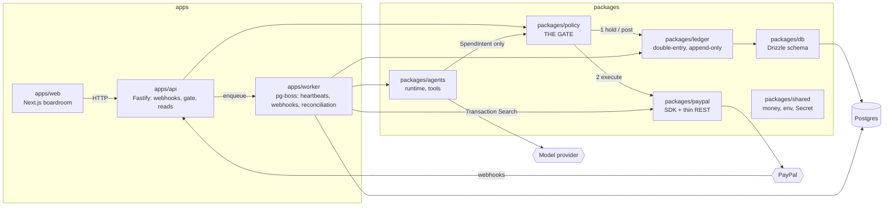

# Architecture

AgPal separates **deciding** to move money from **moving** it. Agents only ever produce
`SpendIntent`s. The policy gate decides, the ledger records, and only then does the PayPal adapter
touch the outside world. The founder's boardroom reads everything through the API.

## Boundaries

| Package           | May depend on                 | Must never                                                |
| ----------------- | ----------------------------- | --------------------------------------------------------- |
| `packages/paypal` | shared                        | depend on policy; leak SDK types                          |
| `packages/policy` | shared, ledger, paypal, db    | let an LLM read or change rule config                     |
| `packages/agents` | shared, policy (intents only) | import paypal or the PayPal SDK                           |
| `apps/*`          | packages except paypal        | import `@agpal/paypal` or the SDK (exceptions get an ADR) |

Import rules for PayPal are enforced by ESLint (`eslint.config.mjs`).

## Policy rule set

Implemented in Prompt 4. See `docs/money-constitution.md` (Prompt 2).
