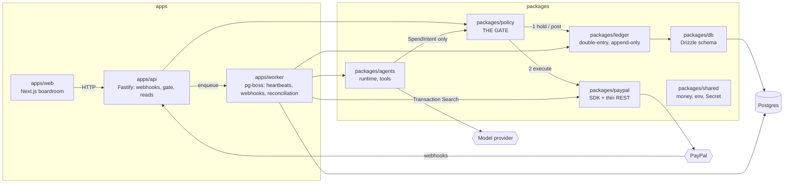

# Architecture

AgPal separates **deciding** to move money from **moving** it. Agents only ever produce
`SpendIntent`s. The policy gate decides, the ledger records, and only then does the PayPal adapter
touch the outside world. The founder's boardroom reads everything through the API.

## Boundaries

| Package           | May depend on                 | Must never                                                |
| ----------------- | ----------------------------- | --------------------------------------------------------- |
| `packages/paypal` | shared                        | depend on policy; leak SDK types                          |
| `packages/policy` | shared, ledger, paypal, db    | let an LLM read or change rule config                     |
| `packages/agents` | shared, policy (intents only) | import paypal or the PayPal SDK                           |
| `apps/*`          | packages except paypal        | import `@agpal/paypal` or the SDK (exceptions get an ADR) |

Import rules for PayPal are enforced by ESLint (`eslint.config.mjs`).

## Policy rule set (packages/policy)

`decide(config, intent, facts)` is a pure function; the `Gate` gathers `facts` under per-envelope and
per-agent advisory locks, records the decision (`spend_intents`, `audit_log`), places a ledger hold, and
executes through a `PaymentsPort` (PayPal, or `FakePayments` in tests and dry mode).

Evaluation order — the first rule that fires wins:

| #   | Rule id                                      | Outcome | Fires when                                                              |
| --- | -------------------------------------------- | ------- | ----------------------------------------------------------------------- |
| 1   | `kill_switch.company` / `kill_switch.agent`  | deny    | company kill switch on, or agent paused                                 |
| 2   | `currency`, `envelope.unknown`               | deny    | wrong currency, no rules for the envelope                               |
| 3   | `action.not_allowed`, `category.not_allowed` | deny    | action or category not in the envelope's config                         |
| 4   | `target.missing`, `target.self`              | deny    | allocation/internal invoice without a valid receiving department        |
| 5   | `cap.per_tx`                                 | deny    | amount > per-tx cap × autonomy multiplier                               |
| 6   | `payee.missing`, `payee.not_allowlisted`     | deny    | payout to a payee not on the founder's allow-list                       |
| 7   | `refund.*`                                   | deny    | refund not tied to a known capture, or more than is still refundable    |
| 8   | `funds.insufficient`                         | deny    | envelope (or unallocated) available < amount (+ payout fee buffer)      |
| —   | `founder.approved`                           | approve | founder approving a held intent (rules 1–8 are re-checked first)        |
| 9   | `always_hold`                                | hold    | action is always held (price changes)                                   |
| 10  | `payee.first_payout`                         | hold    | first payout to a payee                                                 |
| 11  | `cap.daily`                                  | hold    | today's total for envelope + action would exceed daily cap × multiplier |
| 12  | `velocity`                                   | hold    | agent's count of this action in the window ≥ limit                      |
| 13  | `approval_threshold`                         | hold    | amount > auto-approve limit × autonomy multiplier                       |
| 14  | `within_policy`                              | approve | none of the above                                                       |

Approved and held intents that draw on an envelope (payouts, internal invoices) reserve
`amount (+ fee buffer)` as a ledger hold, so concurrent intents cannot spend the same money. Executions
that fail keep their hold and are retried with the same idempotency key (`sender_batch_id` /
`PayPal-Request-Id` = intent id); they are never re-decided. Config is zod-validated per company,
multipliers are basis points, and no LLM can read or write it.
